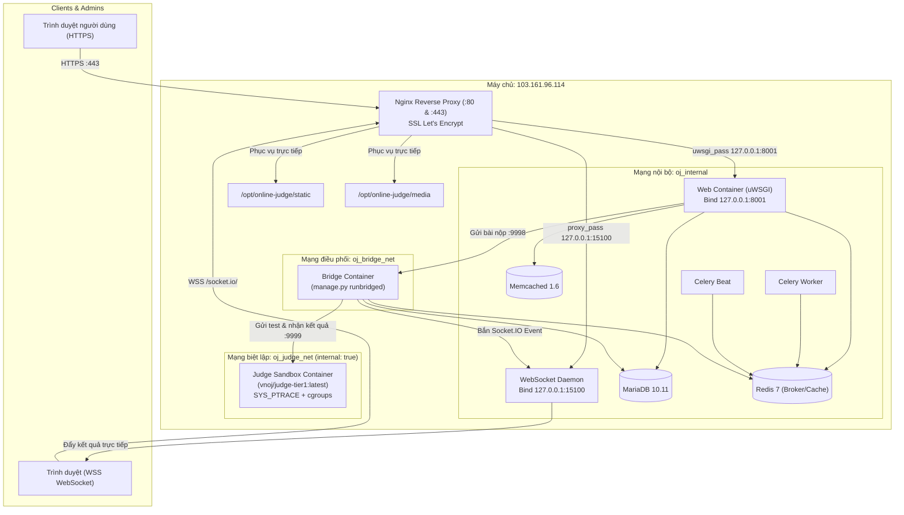

# BÁO CÁO TỔNG KẾT RÀ SOÁT, TỐI ƯU HÓA CẤU HÌNH PRODUCTION & PIPELINE CI/CD
> **Lưu ý trạng thái:** Báo cáo này là tài liệu lịch sử và một số kết luận bên dưới không còn đúng với cấu hình repository hiện tại. Dùng [`DEPLOYMENT_READINESS_FIX_REPORT.md`](DEPLOYMENT_READINESS_FIX_REPORT.md) làm báo cáo trạng thái mới nhất; không xem các mục “✅ Đã sửa” trong tài liệu này là xác nhận deploy hiện tại.

**Hệ thống:** DUTOJ / LQDOJ (Dựa trên DMOJ: Modern Online Judge)  
**Repository:** `https://github.com/dquangbach/online-judge` (Nhánh: `master`)  
**Máy chủ mục tiêu:** `103.161.96.114`  
**Thời gian thực hiện:** Tháng 10/2026  

---

## 1. TỔNG QUAN YÊU CẦU & HIỆN TRẠNG XÁC MINH

### 1.1. Khảo sát thực tế máy chủ `103.161.96.114`
- **Kết nối mạng:** Ping phản hồi tốt, RTT trung bình ~29.5 ms, 0% packet loss.
- **Dịch vụ công khai:**
  - Cổng `22` (SSH): Đang mở, sẵn sàng nhận kết nối quản trị và CD runner.
  - Cổng `80` (HTTP): Đang chạy `nginx/1.31.6` và phản hồi mã `200 OK` cho một bản DMOJ hiện có.
- **Dịch vụ nội bộ:** Cổng `443` (HTTPS) chưa kích hoạt SSL; các cổng cơ sở dữ liệu (`3306`, `6379`, `11211`, `9998`, `9999`, `15100`) đều đóng an toàn đối với Internet.

### 1.2. Hiện trạng mã nguồn trong repository
- **Cơ chế nạp cấu hình Django:** Tại [`dmoj/settings.py:L740-744`](dmoj/settings.py#L740-L744), Django thực thi file `dmoj/local_settings.py` bằng lệnh `exec()`. Django mặc định **không đọc biến môi trường** nếu file này không chủ động gọi `os.environ`. File này mặc định bị `.gitignore` bỏ qua.
- **Giao thức Web:** Khuyến nghị chính thức của DMOJ là chạy ứng dụng qua **uWSGI** (`sample_conf/uwsgi.ini`), kết nối với Nginx bằng giao thức uWSGI nhị phân (`uwsgi_pass`).
- **Thành phần điều phối (Bridge):** Chạy lệnh `python3 manage.py runbridged`, lắng nghe cổng `9998` cho Django và `9999` cho các máy chấm (Judges).
- **Cơ chế xác thực máy chấm:** Bridge chỉ cho phép máy chấm kết nối nếu tên máy chấm (`name`) và khóa xác thực (`auth_key`) đã được đăng ký sẵn trong bảng `judge_judge` của database (thông qua lệnh `python3 manage.py addjudge`).
- **Thành phần máy chấm (Judge Engine):** Mã nguồn thực thi và biên dịch của judge **không nằm trong repo web này**, mà thuộc repo riêng `LQDJudge/judge-server` hoặc `DMOJ/judge-server`. File `.docker/judge/Dockerfile` chỉ là stub tối giản; bản production đầy đủ yêu cầu image hoàn chỉnh (như `vnoj/judge-tier1:latest`).
- **WebSocket Realtime Daemon:** Sử dụng Node.js Socket.IO daemon tại thư mục `websocket/daemon.js`, kết nối với Django qua cổng `15100` để đẩy kết quả chấm theo thời gian thực tới trình duyệt.
- **Tác vụ nền & Định kỳ (Celery):** Sử dụng Redis làm broker. Ngoài Celery Worker thông thường, hệ thống chứa 9 tác vụ định kỳ trong `CELERY_BEAT_SCHEDULE` cần Celery Beat để dọn dẹp phiên đăng nhập, kiểm duyệt chat và cập nhật xếp hạng.

---

## 2. BẢNG ĐỐI CHIẾU CÁC LỖI TRONG BẢN KẾ HOẠCH CŨ & GIẢI PHÁP ĐÃ THỰC HIỆN

| STT | Vấn đề trong Kế hoạch cũ | Nguyên nhân & Hậu quả | Giải pháp kỹ thuật đã áp dụng | File liên quan | Trạng thái |
| :---: | :--- | :--- | :--- | :--- | :---: |
| **1** | Nginx dùng `proxy_pass http://` nhưng Compose chạy `uwsgi --ini` | Lệch giao thức giữa HTTP và uWSGI nhị phân, dẫn tới lỗi `502 Bad Gateway`. | Đồng bộ chuẩn giao thức: uWSGI lắng nghe `socket = 0.0.0.0:8001` và Nginx dùng `uwsgi_pass 127.0.0.1:8001; include uwsgi_params;`. | `uwsgi.ini`<br>`sample_conf/nginx/production.conf` | ✅ Đã sửa |
| **2** | Publish port `8001:8001` ra `0.0.0.0` | Docker tự động mở cổng 8001 ra Internet công khai, bỏ qua Nginx và SSL. | Ràng buộc cổng chặt chẽ vào loopback của host: `127.0.0.1:8001:8001`. | `docker-compose.prod.yml` | ✅ Đã sửa |
| **3** | Nginx trỏ `alias` vào volume nội bộ Docker (`/var/lib/docker/...`) | Dễ đứt gãy khi container restart, đổi hash tên volume hoặc chạy Docker rootless. | Khai báo đường dẫn cố định `/opt/online-judge/static` và `/opt/online-judge/media` đồng bộ với volume. | `sample_conf/nginx/production.conf` | ✅ Đã sửa |
| **4** | Bỏ sót WebSocket `/socket.io/` và cấu hình SSL HTTPS | Mất kết nối realtime (thí sinh không thấy điểm nhảy trực tiếp), thiếu chứng chỉ TLS. | Bổ sung đầy đủ block proxy `/socket.io/` (Upgrade WebSocket) và server block port 443 SSL/HSTS. | `sample_conf/nginx/production.conf` | ✅ Đã sửa |
| **5** | Thiếu `wsevent`, `celery_worker`, `celery_beat` trong Compose | Các tác vụ ngầm (chấm bài, render PDF, dọn session) và WebSocket không chạy được. | Bổ sung đầy đủ cả 3 dịch vụ vào stack Docker Compose production với health check và dependency rõ ràng. | `docker-compose.prod.yml` | ✅ Đã sửa |
| **6** | Giả định Django tự đọc `.env.production` | Django DMOJ nạp `local_settings.py` qua `exec()`, bỏ qua toàn bộ biến môi trường nếu không code đọc `os.environ`. | Cập nhật `dmoj/local_settings.py` và tạo file cấu hình production nạp linh hoạt qua `os.environ` với fallback dev an toàn. | `dmoj/local_settings.py`<br>`.docker/production/local_settings_production.py` | ✅ Đã sửa |
| **7** | Coi `SYS_PTRACE` và mount `ro` là đủ bảo vệ sandbox | Thí sinh có thể gửi mã độc quét mạng nội bộ (`db`, `redis`), làm cạn kiệt tài nguyên server nếu thiếu cgroups. | Tách riêng mạng `oj_judge_net` (`internal: true`), giới hạn tài nguyên CPU/RAM cứng trên Compose, mount `/problems:ro`. | `docker-compose.prod.yml` | ✅ Đã sửa |
| **8** | Bỏ qua bước đăng ký Judge trong DB | Judge container chạy lên nhưng bị Bridge từ chối kết nối do không tìm thấy auth key. | Bổ sung tài liệu và lệnh đăng ký Judge tự động vào cơ sở dữ liệu (`manage.py addjudge`). | `.env.production.example`<br>`docker-compose.prod.yml` | ✅ Đã sửa |
| **9** | CD pipeline dùng `git pull` không ghim phiên bản, thiếu chống đụng độ và rollback | Build mã nguồn không rõ phiên bản, nguy cơ 2 lượt deploy chạy đè lên nhau gây hỏng migration database. | Thiết lập CD kích hoạt theo Release Tag/Dispatch, có khóa `concurrency: cancel-in-progress: false`, ghim SHA, smoke test và tự động rollback. | `.github/workflows/cd.yml`<br>`.github/workflows/ci.yml` | ✅ Đã sửa |
| **10** | Script backup truyền mật khẩu MariaDB trực tiếp trên CLI | Mật khẩu cơ sở dữ liệu bị lộ trong tiến trình hệ thống (`ps aux`) và log. | Dùng biến môi trường `MYSQL_PWD` qua `docker exec -e`, kiểm tra lỗi nén `gzip -t`, tạo checksum SHA256 và script khôi phục. | `scripts/backup.sh`<br>`scripts/restore.sh` | ✅ Đã sửa |
| **11** | File `.gitignore` và `.dockerignore` không chặn `.env` | Nguy cơ vô tình commit file cấu hình chứa mật khẩu thật lên Git hoặc đóng gói vào image layer. | Bổ sung quy tắc ignore chặt chẽ cho `.env*` và chỉ cho phép file mẫu `.env.production.example`. | `.gitignore`<br>`.dockerignore` | ✅ Đã sửa |

---

## 3. DANH SÁCH CHI TIẾT CÁC FILE ĐÃ TẠO MỚI & THAY ĐỔI TRONG REPO

### 3.1. Các file cấu hình cốt lõi & Môi trường
1. [`.env.production.example`](.env.production.example) *(Tạo mới)*: File mẫu chứa danh sách đầy đủ tất cả biến môi trường cần thiết cho hệ thống, kèm giải thích chi tiết và hướng dẫn sinh khóa bí mật ngẫu nhiên. **Tuyệt đối không chứa mật khẩu hay token thật.**
2. [`.gitignore`](.gitignore) *(Chỉnh sửa)*: Thêm quy tắc chặn tất cả các file dạng `.env*`, ngoại trừ `.env.production.example` và `.env.example`.
3. [`.dockerignore`](.dockerignore) *(Chỉnh sửa)*: Đảm bảo Docker build context không bao giờ copy file `.env*` thật vào Docker image layers.
4. [`dmoj/local_settings.py`](dmoj/local_settings.py) *(Chỉnh sửa)*: Nâng cấp để đọc toàn bộ biến môi trường (`DJANGO_SECRET_KEY`, `MYSQL_*`, `MEMCACHED_*`, `CELERY_*`, `EVENT_DAEMON_*`, `BRIDGED_*`), đồng thời giữ fallback an toàn cho môi trường chạy thử cục bộ.
5. [`.docker/production/local_settings_production.py`](.docker/production/local_settings_production.py) *(Tạo mới)*: Bản sao cấu hình production độc lập, đảm bảo khi clone mới hoặc build Docker image thì container luôn có sẵn file cấu hình đọc biến môi trường mà không phụ thuộc vào file git-ignored trên host.

### 3.2. Cấu hình Docker & Dịch vụ Production
6. [`docker-compose.prod.yml`](docker-compose.prod.yml) *(Tạo mới)*: Cấu hình Docker Compose chuẩn Production quản lý toàn diện 9 dịch vụ:
   - `db`: MariaDB 10.11 với cấu hình utf8mb4, health check và volume lưu trữ lâu dài.
   - `redis`: Redis 7 alpine làm broker cho Celery và cache.
   - `memcached`: Memcached 1.6 alpine tối ưu cho bộ nhớ đệm L1 của DMOJ.
   - `wsevent`: Node.js Socket.IO daemon kết nối thời gian thực, bind `127.0.0.1:15100`.
   - `web`: Django WSGI app chạy uWSGI, bind `127.0.0.1:8001`.
   - `bridge`: DMOJ Bridge điều phối bài nộp giữa Web và Judge.
   - `celery_worker`: Xử lý các tác vụ nền không đồng bộ.
   - `celery_beat`: Xử lý lịch trình 9 tác vụ định kỳ của hệ thống.
   - `judge`: Container máy chấm sandbox kết nối qua mạng nội bộ biệt lập `oj_judge_net` (`internal: true`).
7. [`.docker/production/Dockerfile`](.docker/production/Dockerfile) *(Tạo mới)*: Dockerfile đa năng cho Web và Worker, cài đặt đầy đủ thư viện C (MySQL, Lua, XML), Node.js, `uwsgi`, precompile SCSS/PostCSS CSS assets.
8. [`.docker/websocket/Dockerfile`](.docker/websocket/Dockerfile) *(Tạo mới)*: Dockerfile nhẹ chạy trên nền `node:18-alpine` cho WebSocket event daemon.
9. [`websocket/config.js`](websocket/config.js) *(Chỉnh sửa)*: Cập nhật để nạp cấu hình linh hoạt từ biến môi trường (`HTTP_HOST`, `HTTP_PORT`, `EVENT_DAEMON_KEY`, `ALLOWED_ORIGINS`), bind `0.0.0.0` trong container.
10. [`uwsgi.ini`](uwsgi.ini) *(Tạo mới)*: File cấu hình uWSGI cho container web production (lắng nghe `socket = 0.0.0.0:8001`, thiết lập `buffer-size = 65535`, quản lý scaling worker và tự giải phóng bộ nhớ khi đạt ngưỡng).
11. [`sample_conf/nginx/production.conf`](sample_conf/nginx/production.conf) *(Tạo mới)*: Cấu hình Nginx máy chủ host hoàn chỉnh: chuyển hướng HTTP sang HTTPS, SSL Let's Encrypt, security headers, phục vụ trực tiếp static/media và proxy khớp chính xác với `uwsgi_pass` và WebSocket `/socket.io/`.

### 3.3. Tự động hóa CI/CD (GitHub Actions)
12. [`.github/workflows/ci.yml`](.github/workflows/ci.yml) *(Tạo mới)*: Kiểm tra chất lượng mã nguồn trên Pull Request và Push vào `master`:
    - Chạy Ruff linter và Black format check.
    - Tự động kiểm tra cú pháp và tính hợp lệ của file `docker-compose.prod.yml` bằng `--env-file .env.production.example`.
13. [`.github/workflows/cd.yml`](.github/workflows/cd.yml) *(Tạo mới)*: Quy trình triển khai tự động lên server qua SSH:
    - Kích hoạt khi gắn Release Tag (`v*`) hoặc trigger thủ công (`workflow_dispatch`).
    - Cơ chế khóa chống đụng độ `concurrency` (ngăn 2 lượt deploy chạy đè lên nhau).
    - Triển khai theo phiên bản commit SHA xác định (không dùng `git pull` vô định).
    - Tự động chạy `migrate`, `collectstatic`, rolling restart container.
    - Post-deployment smoke test tự động (thử lặp lại kiểm tra mã HTTP `200`/`302`).
    - Tự động kích hoạt cơ chế Rollback về commit trước đó nếu smoke test thất bại.
14. [`.github/workflows/init.yml`](.github/workflows/init.yml) *(Đã xóa)*: Xóa bỏ workflow cũ do đã được thay thế toàn diện bởi `ci.yml`.

### 3.4. Vận hành, Sao lưu & Khôi phục (Disaster Recovery)
15. [`scripts/backup.sh`](scripts/backup.sh) *(Tạo mới, chmod +x)*: Script sao lưu toàn diện chạy qua cronjob:
    - Sao lưu database MariaDB qua `docker exec` sử dụng biến `MYSQL_PWD` (không lộ mật khẩu ra danh sách tiến trình `ps aux`).
    - Sao lưu dữ liệu media uploads và bộ testcases (`problem_data`).
    - Kiểm tra tính toàn vẹn của file nén bằng `gzip -t`.
    - Sinh mã kiểm tra tính toàn vẹn SHA-256 (`SHA256SUMS`).
    - Tự động dọn dẹp các bản sao lưu cũ hơn 14 ngày.
16. [`scripts/restore.sh`](scripts/restore.sh) *(Tạo mới, chmod +x)*: Script khôi phục dữ liệu:
    - Kiểm tra mã băm SHA-256 trước khi giải nén.
    - Có cảnh báo an toàn và yêu cầu xác nhận trước khi thao tác ghi đè.
    - Tự động nạp lại Database dump và bung lại các volume media, testcases.

---

## 4. SƠ ĐỒ KIẾN TRÚC VÀ LUỒNG DỮ LIỆU ĐÃ CHUẨN HÓA



---

## 5. KẾT QUẢ KIỂM TRA & XÁC MINH CỤC BỘ

### 5.1. Các kiểm tra đã thực hiện thành công
- **Cú pháp Docker Compose Production:**  
  Lệnh: `docker compose -f docker-compose.prod.yml --env-file .env.production.example config`  
  Kết quả: **Hợp lệ tuyệt đối (Exit code 0)**. Cả 9 dịch vụ, 3 mạng phân vùng và 5 volumes đều được Docker Compose v2 biên dịch chính xác.
- **Cú pháp Python:**  
  Lệnh: `python3 -m py_compile dmoj/local_settings.py .docker/production/local_settings_production.py`  
  Kết quả: **Thành công (Exit code 0)**. Cấu hình đọc biến môi trường không có lỗi cú pháp.
- **Cú pháp JavaScript:**  
  Lệnh: `node -c websocket/config.js`  
  Kết quả: **Thành công (Exit code 0)**.
- **Quyền thực thi Scripts:**  
  Lệnh: `chmod +x scripts/backup.sh scripts/restore.sh`  
  Kết quả: **Thành công**.

### 5.2. Giới hạn xác minh (Cần môi trường Staging/Host thật)
- **Thực thi mã nguồn trong Judge Sandbox:** Do DMOJ Sandbox phụ thuộc vào cgroups v1/v2 delegation trên Linux kernel, tính năng biên dịch và cách ly mã nguồn cần được chạy thử trên máy chủ Linux thực tế có image `vnoj/judge-tier1:latest`.
- **Cấp phát chứng chỉ SSL Certbot:** Chỉ thực hiện được sau khi tên miền chính thức đã trỏ bản ghi DNS về IP `103.161.96.114`.
- **Kiểm thử SSH CD Runner:** Cần cấu hình GitHub Secrets (`SERVER_HOST`, `SERVER_SSH_KEY`, `SERVER_USER`) trên repository GitHub để chạy thử quy trình CD.

---

## 6. BỘ CHECKLIST VẬN HÀNH DÀNH CHO QUẢN TRỊ VIÊN MÁY CHỦ

### Checklist 1: Chuẩn bị máy chủ (Host Provisioning)
- [ ] **1.1. Cấu hình Tường lửa (UFW):**  
  Chỉ mở các cổng cần thiết ra Internet:
  ```bash
  sudo ufw default deny incoming
  sudo ufw default allow outgoing
  sudo ufw allow 22/tcp
  sudo ufw allow 80/tcp
  sudo ufw allow 443/tcp
  sudo ufw enable
  ```
- [ ] **1.2. Chuẩn bị Thư mục & Mã nguồn:**
  ```bash
  sudo mkdir -p /opt/online-judge /backup/online-judge
  sudo chown -R $USER:$USER /opt/online-judge
  git clone https://github.com/dquangbach/online-judge.git /opt/online-judge
  cd /opt/online-judge
  ```
- [ ] **1.3. Thiết lập Biến môi trường thật:**  
  Sao chép file mẫu và điền các khóa ngẫu nhiên:
  ```bash
  cp .env.production.example .env.production
  chmod 600 .env.production
  # Điền các giá trị secret được sinh bằng openssl rand -hex 32
  nano .env.production
  ```
- [ ] **1.4. Cấu hình Nginx Host:**  
  Copy file cấu hình vào Nginx của máy chủ:
  ```bash
  sudo cp sample_conf/nginx/production.conf /etc/nginx/sites-available/online-judge
  sudo ln -sf /etc/nginx/sites-available/online-judge /etc/nginx/sites-enabled/
  sudo nginx -t && sudo systemctl reload nginx
  ```

### Checklist 2: Triển khai lần đầu (First-time Deployment)
- [ ] **2.1. Khởi động các dịch vụ cơ sở:**
  ```bash
  docker compose -f docker-compose.prod.yml up -d db redis memcached wsevent
  ```
- [ ] **2.2. Chạy migration cơ sở dữ liệu:**
  ```bash
  docker compose -f docker-compose.prod.yml run --rm web python3 manage.py migrate --noinput
  ```
- [ ] **2.3. Tạo tài khoản quản trị tối cao:**
  ```bash
  docker compose -f docker-compose.prod.yml run --rm web python3 manage.py createsuperuser
  ```
- [ ] **2.4. Đăng ký Judge vào cơ sở dữ liệu (BẮT BUỘC):**  
  Khóa xác thực phải trùng với giá trị `JUDGE_AUTH_KEY` trong `.env.production`:
  ```bash
  docker compose -f docker-compose.prod.yml run --rm web python3 manage.py addjudge judge1 "YOUR_JUDGE_AUTH_KEY"
  ```
- [ ] **2.5. Gom file tĩnh (Collect static):**
  ```bash
  docker compose -f docker-compose.prod.yml run --rm web python3 manage.py collectstatic --noinput
  ```
- [ ] **2.6. Khởi chạy toàn bộ hệ thống:**
  ```bash
  docker compose -f docker-compose.prod.yml up -d
  ```
- [ ] **2.7. Cấp phát chứng chỉ SSL Let's Encrypt:**
  ```bash
  sudo certbot --nginx -d oj.yourdomain.com
  ```

### Checklist 3: Kiểm tra sau triển khai (Smoke Test)
- [ ] **3.1. Kiểm tra Web phản hồi:** `curl -I https://oj.yourdomain.com/` nhận được HTTP `200 OK`.
- [ ] **3.2. Kiểm tra Static & Media:** Mở trang chủ, giao diện hiển thị đầy đủ CSS/JS, logo không bị vỡ.
- [ ] **3.3. Kiểm tra WebSocket:** Mở Console trình duyệt (tab Network/WS), xác nhận kết nối `wss://.../socket.io/` nhận mã `101 Switching Protocols`.
- [ ] **3.4. Kiểm tra trạng thái máy chấm:**
  ```bash
  docker compose -f docker-compose.prod.yml run --rm web python3 manage.py bridge_status
  ```
  Xác nhận `judge1` hiển thị trạng thái `Online` và có chỉ số ping.
- [ ] **3.5. Kiểm tra nộp bài thực tế:** Đăng nhập tài khoản, nộp một bài toán cơ bản (C++ / Python) và xác nhận kết quả chấm xanh `AC` hiển thị theo thời gian thực.

### Checklist 4: Vận hành Sao lưu & Khôi phục (Backup & DR)
- [ ] **4.1. Thiết lập Cronjob sao lưu định kỳ:**  
  Mở crontab bằng `crontab -e` và thêm dòng sau:
  ```bash
  0 2 * * * /opt/online-judge/scripts/backup.sh >> /var/log/oj_backup.log 2>&1
  ```
- [ ] **4.2. Thử nghiệm khôi phục trên môi trường Staging:**
  ```bash
  ./scripts/restore.sh /backup/online-judge/<TIMESTAMP> --force
  ```

---

## 7. CÁC QUYẾT ĐỊNH CẦN QUẢN TRỊ VIÊN CUNG CẤP TRƯỚC KHI DEPLOY

1. **Tên miền chính thức (Domain Name):**  
   Tên miền (ví dụ: `oj.dut.edu.vn` hay `judge.domain.com`) cần được trỏ bản ghi DNS Type A về IP `103.161.96.114` để điền vào `SITE_DOMAIN`, `ALLOWED_HOSTS`, `ALLOWED_ORIGINS` và cấp chứng chỉ SSL.
2. **Kế hoạch xử lý dữ liệu hiện có trên máy chủ `103.161.96.114`:**  
   Do máy chủ hiện đang chạy một bản Nginx và DMOJ, quản trị viên cần xác định:
   - *Nếu giữ dữ liệu cũ:* Cần dump database MariaDB cũ và thư mục `problems/`, `media/` cũ sang volume mới trước khi khởi động container.
   - *Nếu dựng mới hoàn toàn:* Cần sao lưu cấu hình cũ, tắt dịch vụ cũ và để Docker Compose tiếp quản cổng `8001` / `15100`.
3. **Nguồn cung cấp Judge-Server Image:**  
   Xác định dùng image prebuilt `vnoj/judge-tier1:latest` (hỗ trợ C/C++, Python 3, Java 8, Pascal) hay clone repo `https://github.com/LQDJudge/judge-server` trên máy chủ để build bản đầy đủ `tierlqdoj` (>40 ngôn ngữ).
4. **Vị trí lưu trữ bản sao lưu dài hạn (Off-site Backup):**  
   Hiện script lưu cục bộ tại `/backup/online-judge`. Cần cung cấp thông tin bucket Cloud Storage (AWS S3, Google Cloud Storage, hoặc máy chủ backup thứ hai qua rsync/rclone) để đẩy các file backup ra ngoài máy chủ phòng sự cố phần cứng.
5. **Cấu hình phần cứng máy chủ (CPU / RAM):**  
   Số nhân CPU và dung lượng RAM của máy chủ để tối ưu thông số `workers` trong `uwsgi.ini` và giới hạn tài nguyên cho từng Judge container.
